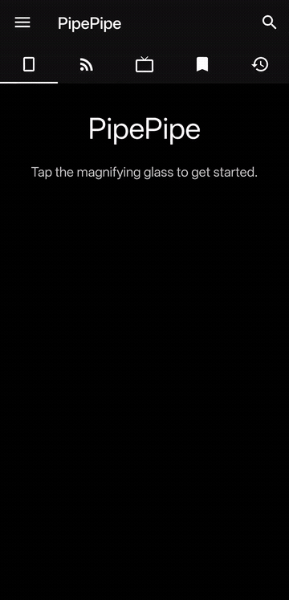
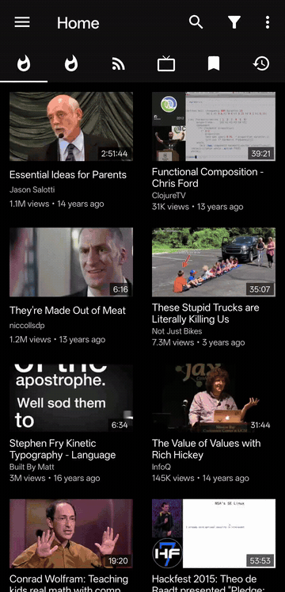
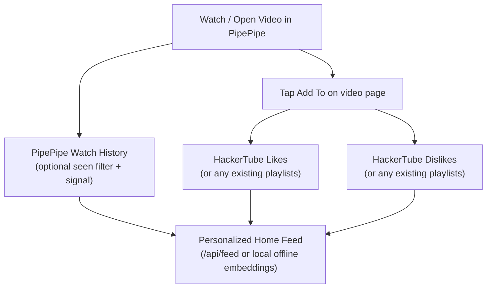
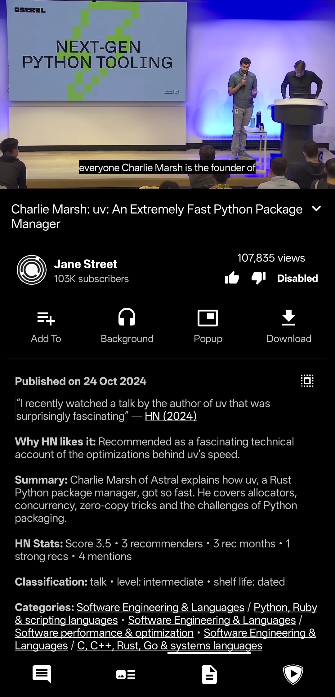
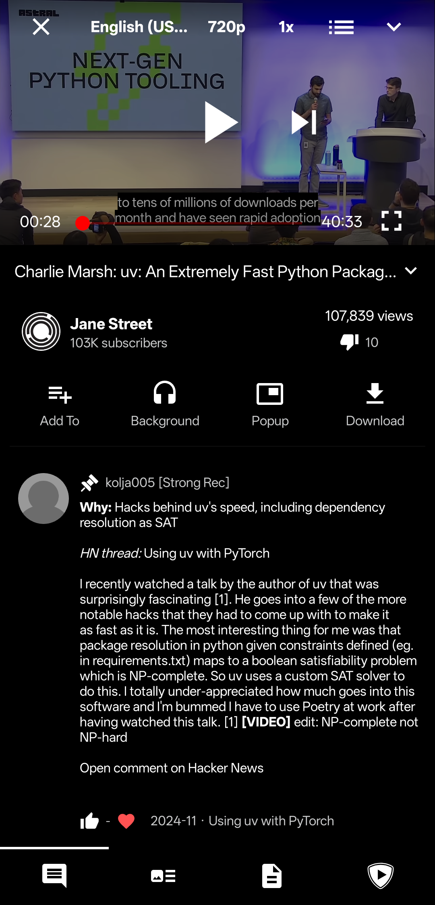
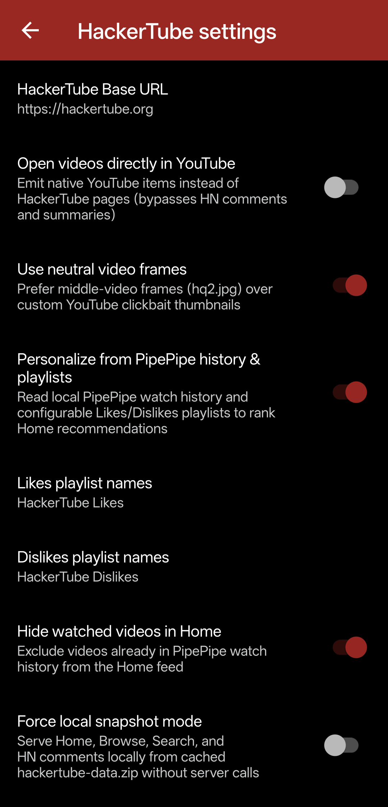

# Hackertube-PipePipePlugin

This plugin adds support for browsing [HackerTube](https://hackertube.org), a frontend for a curated list of YouTube videos recommended on [HN](https://news.ycombinator.com/item?id=50319510), from [PipePipe](https://github.com/InfinityLoop1308/PipePipe).

> **Note**
> This is a personal project created for my own use and was developed with AI assistance (Gemini 4 Hydrogen). My contribution was just providing high-level directions and editing this document so it's easier for anyone else who wishes to try it out.

## Overview

- The sections from the webpage were recreated as kiosk cards, these include: Home (Personalized feed), Longs, Categories, Curated Playlists, etc.
- On each video stream page you can read the HackerTube summary, HN stats and mentions as comments (clickable), and related videos.
- Optionally it can also read your local PipePipe watch history, Likes & Dislikes playlists to influence feed recommendations.
- In case [the site](https://hackertube.org/) ever goes offline, we store `hackertube-data.zip` and curated playlist metadata locally so search, comments, and recommendations keep working offline.

## How to use


### 1. Install the plugin repository

1. Open `PipePipe -> Settings -> Plugins` and toggle `Allow plugins` on.
2. Scroll to the bottom, in `Plugins -> Repositories section` click `Add repository` and paste:
   ```text
   https://github.com/Sad-dy/Hackertube-PipePipePlugin/releases/download/repo/index.json
   ```
3. In Plugins, find `HackerTube` under Available section and install it.

### 2. Browse Kiosks and using search filters

Once the above steps are completed you will find `HackerTube` in the installed section of Plugins. 

- Open the left navigation drawer and switch the active service (top bar) to **HackerTube** to open **Home**, **Longs**, **Categories**, **Playlists**, **Hidden gems**, **Recently recommended**, or **Top ranked**.
- Drawer kiosk cards do not show Search (magnifying glass) icon. To use full HackerTube search filters (for *Category, Area, Type, Level, Date, Min HN Points,* and *Sort*), open **Settings -> Appearance -> Content of main page**, tap **`+`**, pick **Kiosk → HackerTube → Home**, and move it to the top if desired.

<details>
<summary> Expand to see demo videos </summary>
<table>
  <tr>
    <td align="center" width="33%">
      <br />
      <sub><strong>1. Switch service &amp; browse kiosks</strong></sub>
    </td>
    <td align="center" width="33%">
      <br />
      <sub><strong>2. Pin Home &amp; Top ranked cards to main page</strong></sub>
    </td>
    <td align="center" width="33%">
      <br />
      <sub><strong>3. Search with expanded filters</strong></sub>
    </td>
  </tr>
</table>
</details>

### 3. Likes, Dislikes, Bookmarks & Watch History (Personalization)

In PipePipe plugins cannot work on player's thumbs-up/down controls directly, so likes and dislikes use bookmarked playlists via `Add To`:



- On first launch, the plugin creates `HackerTube Likes` and `HackerTube Dislikes` playlists in PipePipe
- To reuse your existing playlists open **Settings → Plugins → HackerTube → Settings** and edit **Likes playlist names** and/or **Dislikes playlist names**

### 4. Modify Comments: HN comment/quotes & normal YouTube comments

- The **Comments** tab displays Hacker News mentions (`[Strong Rec]`, `[Rec]`, `[Reference]`, `[Critical]`, `[Joke]`) and quotes the comment along with HN comment URL on the first line.
- To see actual YT video comments instead of these HN ones, enable **Open videos directly in YouTube** in HackerTube Plugin settings.


<table>
  <tr>
    <td align="center" width="33%">
      <br />
      <sub><strong>Description &amp; HN summary</strong></sub>
    </td>
    <td align="center" width="33%">
      <br />
      <sub><strong>HN quote comments</strong></sub>
    </td>
    <td align="center" width="33%">
      <br />
      <sub><strong>Plugin settings</strong></sub>
    </td>
  </tr>
</table>

### 5. Settings reference

Configure everything in **Settings → Plugins → HackerTube → Settings**:

| Setting | Default | What it does |
| --- | --- | --- |
| **HackerTube Base URL** | `https://hackertube.org` | Base URL or self-hosted mirror |
| **Open videos directly in YouTube** | `false` | Bypass HackerTube stream page to open native YouTube comments/likes |
| **Use neutral video frames** | `true` | Prefer middle-video frames (`hq2.jpg`) over custom clickbait thumbnails |
| **Personalize from PipePipe history & playlists** | `true` | Rank Home using PipePipe Watch History + Likes/Dislikes playlists |
| **Likes playlist names** | `HackerTube Likes` | Comma-separated PipePipe playlist names treated as positive signals |
| **Dislikes playlist names** | `HackerTube Dislikes` | Comma-separated PipePipe playlist names treated as negative signals |
| **Hide watched videos in Home** | `true` | Hide videos already in PipePipe Watch History from Personalized Home |
| **Force local snapshot mode** | `false` | Serve Home, Browse, Search, and HN comments offline from `hackertube-data.zip` |
| **Hide news items in feeds** | `true` | Exclude short-lived `shelf_life=news` videos from Home/Browse (still searchable) |
| **Hide unrecommended citations in Home** | `true` | Only show videos with `hn.recommenders > 0` in Home |
| **Snapshot refresh interval (hours)** | `168` | Background sync cadence for `hackertube-data.zip` and curated playlists (`0` disables) |


